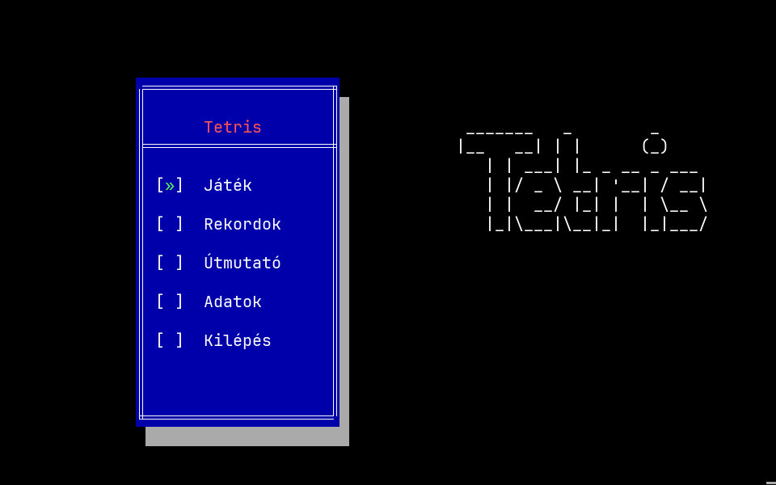
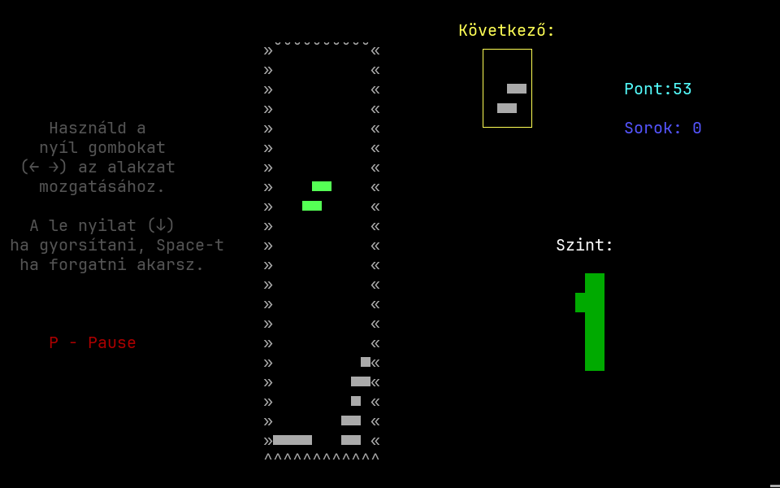
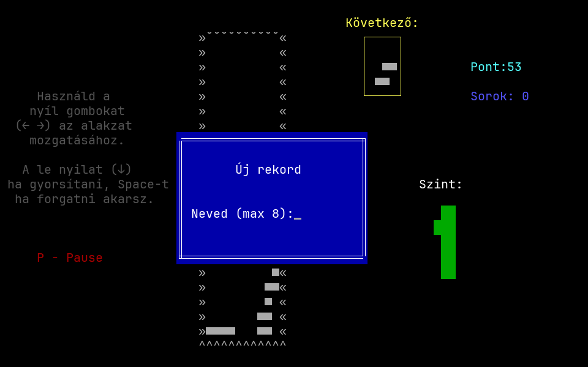
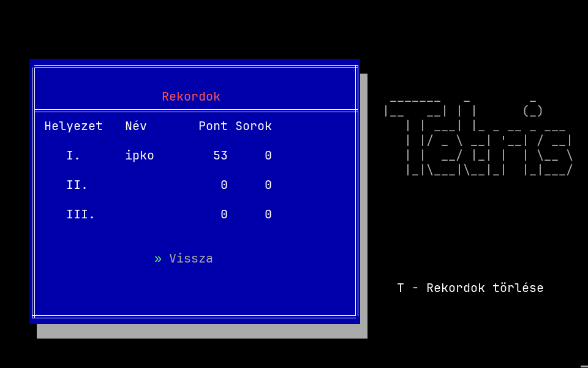

# Pascal Tetris

A text-mode Tetris I wrote in Free Pascal in 2014, when I was 17 and just
starting to program. It has an animated intro, a menu, a high-score table, a
help screen, levels and a next-piece preview, all drawn with the `crt` unit
in an 80×25 console. The UI is in Hungarian.

The original Pascal source is kept untouched. Next to it is a C port that runs
in any modern Linux/macOS terminal and reproduces the original exactly,
including its bugs.





| New record | High scores |
|---|---|
|  |  |

More in [`screenshots/`](screenshots/).

## Files

| File | What it is |
|---|---|
| `Tetris.pas` | The original 2014 source (Free Pascal, `crt` + `dos` units). Encoded in **CP852** (DOS Central European), not UTF-8. |
| `tetris.c` | A C port of `Tetris.pas`. **AI-written** (Claude), a line-by-line translation of the Pascal code plus a small `crt` emulation layer for ANSI terminals. |
| `Makefile` | Builds the C version. |
| `screenshots/` | Screenshots of the C version. |

## Running the C version

You need a C compiler (gcc or clang). No other libraries are required.

```sh
make            # or: gcc -O2 -o tetris tetris.c
./tetris
```

The terminal must be at least **80×25** and support 24-bit colour (any modern
terminal does). High scores are saved to `rekordok.txt` in the current
directory.

## Running the original Pascal version

Compile with [Free Pascal](https://www.freepascal.org/):

```sh
fpc Tetris.pas
```

The source and its output use code page 852, so run it in a console using
that code page (on Windows: `chcp 852` before starting `Tetris.exe`).
Otherwise the box-drawing characters and accented letters come out garbled.

## How to play

| Key | Menu | Game |
|---|---|---|
| ↑ / ↓ | Move selection | ↓ soft drop (+1 point) |
| ← / → | | Move piece |
| Space | | Rotate |
| Enter | Select / back | Start the game |
| P or Esc | | Pause (then **P** resume, **K** quit) |
| T | Clear high scores (on the *Rekordok* screen) | |

A cleared line is worth 50 points. The game speeds up every 3 lines, up to level 5.

### Menu translations

| Hungarian | English |
|---|---|
| Játék | Play |
| Rekordok | High scores |
| Útmutató | Instructions |
| Adatok | About |
| Kilépés | Quit |

## About the C port

The goal of the port was a faithful replica rather than a cleaned-up remake, so
the original's quirks are kept on purpose:

- The T piece never appears (`random(6)+1` only picks pieces 1–6).
- Game over is detected one piece late.
- Uppercase `P` acts as soft drop (it shares its code with the ↓ arrow), and the
  left arrow quits from the pause screen (it shares its code with `K`).
- The score label turns into `Pont:53` (no space) after its first update.
- The high-score file grows a little every save, because the line count gets
  read back as part of the name.

The port emulates the `crt` unit on top of ANSI escape codes: an 80×25 screen
buffer, the 16 VGA colours, CP852 glyphs, `keypressed`/`readkey` with
`#0`+scan-code extended keys, and FPC text-file read semantics. Ctrl+C quits.
